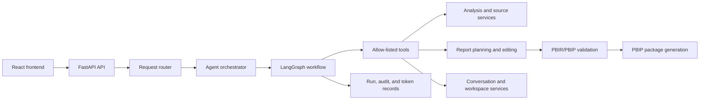

# AURA agent architecture

AURA separates request routing, agent planning, bounded tool execution, and
domain services. The API accepts a user request and source context, the router
selects an allow-listed action, and the orchestrator validates the resulting
plan before execution.

## Agent roles

- **Router:** classifies a request into an allowed action and determines
  whether a report draft is already present.
- **Orchestrator:** validates plans, applies approval boundaries, and records
  the execution context.
- **Workflow:** runs bounded steps, carries outputs into later steps, retries
  recoverable report-plan failures, and stops when clarification or approval is
  required.
- **Tools:** expose schema-bound data analysis, report operations, workbook
  inspection, conversation memory, and workspace actions.
- **AI provider:** uses Azure OpenAI in configured deployments or the local
  mock provider for tests and development.

## Safety boundaries

Data queries are read-only and bounded. Report plans are validated before
preview or generation. PBIP generation is a separate approved operation, and
generated paths are checked to remain inside the configured workspace. Audit
records exclude raw workbook rows and tool outputs.

The implementation is organized as follows:

- `backend/agents/` contains routing, orchestration, workflow, prompts, and
  execution adapters.
- `backend/tools/` contains stable tool contracts.
- `backend/services/` contains domain logic and persistence.
- `automation/` contains workbook analysis, semantic validation, report
  generation, and Azure AI integration.
