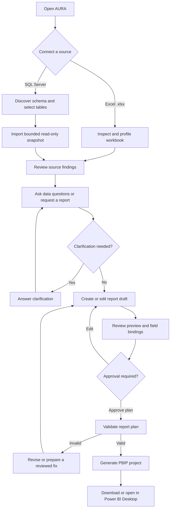

# AURA user journey

The normal workflow keeps source connection, analysis, report editing,
approval, and generation as distinct stages.

Important boundaries:

- SQL imports are bounded snapshots, not live Power BI connections.
- Excel formulas are not recalculated; saved formula results may be stale.
- Browser previews are approximate and must be verified in Power BI Desktop.
- A chat request cannot silently approve or generate a report.
- Generated PBIP projects are local artifacts; AURA does not publish to Power
  BI Service or create `.pbix` files.
